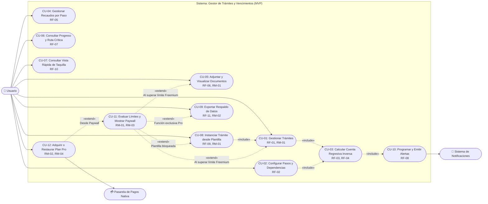

# 2026-11-20 — Gestor de Trámites y Vencimientos Burocráticos/Legales con Dependencias - Casos de Uso MVP

## 1. Identificación de Actores

* **Usuario (Actor Principal):** Persona natural que gestiona sus trámites burocráticos o legales personales. Puede operar bajo dos perfiles funcionales según su estado comercial:
  * *Usuario Freemium:* Sujeto a límites operativos (máximo 3 trámites activos, 5 archivos adjuntos, 2 plantillas base y sin exportación de respaldo).
  * *Usuario Personal Pro:* Usuario con suscripción anual o licencia *Lifetime* activa, con acceso ilimitado a todas las funcionalidades del MVP.
* **Sistema de Notificaciones del Dispositivo (Actor Secundario / Sistema Externo):** Servicio nativo de notificaciones push/locales del sistema operativo móvil encargado de programar, persistir tras reinicios y entregar las alertas de ventana de acción y riesgo de retraso.
* **Pasarela de Pagos Nativa (Actor Secundario / Sistema Externo):** Servicio comercial de la tienda de aplicaciones (App Store / Google Play) encargado de procesar las compras integradas (*In-App Purchases*) y validar el historial de transacciones para restauración de licencias.

---

## 2. Diagrama de Casos de Uso (Notación Mermaid)

# 3. Especificación Detallada de Casos de Uso

## CU-01: Gestionar Trámites
* **Requerimientos asociados:** RF-01, RM-01, RM-03.
* **Actor principal:** Usuario.
* **Descripción:** Permite crear, editar, consultar y eliminar trámites burocráticos o legales.
* **Flujo preliminar conceptual:**
  1. El usuario selecciona crear un nuevo trámite e ingresa título, categoría, fecha límite final y notas generales.
  2. El sistema verifica si el usuario es Freemium y si ya alcanzó el límite de 3 trámites activos (si lo supera, se extiende hacia CU-11).
  3. El sistema registra el trámite y dispara automáticamente el cálculo de fechas (CU-03).
  4. Ante ediciones de fecha límite o eliminación de trámites, el sistema actualiza el registro y recalcula o limpia las alertas asociadas.

---

## CU-02: Configurar Pasos y Dependencias
* **Requerimientos asociados:** RF-02, RF-04.
* **Actor principal:** Usuario.
* **Descripción:** Permite estructurar la cadena de prerequisitos secuenciales dentro de un trámite.
* **Flujo preliminar conceptual:**
  1. Dentro de un trámite, el usuario añade uno o más pasos previos (prerequisitos).
  2. Para cada paso define su nombre, orden de dependencia secuencial y el tiempo de anticipación requerido (días, semanas o meses) respecto al paso siguiente o la fecha límite final.
  3. Al guardar o reordenar los pasos, el sistema invoca obligatoriamente el motor de cálculo inverso (CU-03).

---

## CU-03: Calcular Cuenta Regresiva Inversa
* **Requerimientos asociados:** RF-03, RF-04, RNF-03.
* **Actor principal:** Sistema (ejecutado por inclusión desde CU-01 y CU-02).
* **Descripción:** Motor de programación hacia atrás (*backward scheduling*) que determina cuándo debe iniciar cada paso previo.
* **Flujo preliminar conceptual:**
  1. El sistema toma la fecha límite final del trámite como punto de anclaje.
  2. Recorre la cadena de dependencias en orden inverso, restando la duración/anticipación de cada paso para fijar su fecha de inicio y vencimiento interno.
  3. Si ocurre un cambio posterior en fechas o duraciones, ejecuta el recálculo dinámico en tiempo real (< 1 segundo) y actualiza la programación de alertas (CU-10).

---

## CU-04: Gestionar Recaudos por Paso
* **Requerimientos asociados:** RF-05.
* **Actor principal:** Usuario.
* **Descripción:** Permite definir y controlar la lista de verificación documental exigida en cada etapa del trámite.
* **Flujo preliminar conceptual:**
  1. El usuario selecciona un paso previo dentro de un trámite.
  2. Agrega los recaudos requeridos (ej. formulario impreso, timbre fiscal, copia de identidad).
  3. Marca cada recaudo como *Pendiente* o *Listo* a medida que los obtiene, actualizando el porcentaje de avance del paso.

---

## CU-05: Adjuntar y Visualizar Documentos
* **Requerimientos asociados:** RF-06, RNF-01, RNF-02, RM-01, RM-03.
* **Actor principal:** Usuario.
* **Descripción:** Permite respaldar digitalmente los recaudos mediante fotografías o archivos PDF y consultarlos sin conexión.
* **Flujo preliminar conceptual:**
  1. El usuario selecciona un recaudo o paso y elige subir una imagen o documento PDF desde su dispositivo o cámara.
  2. El sistema valida la cuota de almacenamiento; si es Freemium e intenta subir un 6.º archivo, activa el Paywall (CU-11).
  3. El sistema cifra y almacena localmente el archivo para garantizar disponibilidad *offline* y privacidad.
  4. El usuario puede abrir el visor integrado en cualquier momento para previsualizar el documento de forma inmediata.

---

## CU-06: Consultar Progreso y Ruta Crítica
* **Requerimientos asociados:** RF-07, RNF-04.
* **Actor principal:** Usuario.
* **Descripción:** Presenta el estado operativo del trámite en función de la fecha actual y destaca la acción inmediata requerida.
* **Flujo preliminar conceptual:**
  1. El usuario accede al panel principal de trámites.
  2. El sistema evalúa la fecha actual frente a las fechas calculadas y clasifica cada trámite: *En espera/latente* (oculto o atenuado para evitar ruido), *En ventana de acción*, *En riesgo* o *Completado*.
  3. El sistema resalta visualmente el próximo paso crítico que requiere atención inmediata.

---

## CU-07: Consultar Vista Rápida de Taquilla
* **Requerimientos asociados:** RF-10, RNF-02.
* **Actor principal:** Usuario.
* **Descripción:** Modo de consulta simplificada ("Listo para cita / taquilla") optimizado para uso presencial en oficinas o consulados.
* **Flujo preliminar conceptual:**
  1. El usuario activa la vista resumida dentro de un trámite activo.
  2. El sistema filtra la interfaz ocultando configuraciones de fechas y dependencias, mostrando únicamente el listado consolidado de recaudos y los accesos directos a sus archivos adjuntos cifrados en almacenamiento local.

---

## CU-08: Instanciar Trámite desde Plantilla
* **Requerimientos asociados:** RF-09, RM-01, RM-03.
* **Actor principal:** Usuario.
* **Descripción:** Agiliza la creación de trámites frecuentes utilizando estructuras preconfiguradas.
* **Flujo preliminar conceptual:**
  1. El usuario explora el catálogo de plantillas base (ej. pasaporte, licencia, seguro).
  2. Si es Freemium y selecciona una plantilla fuera de las 2 gratuitas habilitadas, se dispara CU-11.
  3. El usuario ingresa únicamente la fecha límite objetivo; el sistema clona los pasos previos y recaudos sugeridos, crea el trámite (CU-01) y permite editar libremente la estructura resultante.

---

## CU-09: Exportar Respaldo de Datos
* **Requerimientos asociados:** RF-11, RNF-06, RM-02, RM-03.
* **Actor principal:** Usuario (Personal Pro).
* **Descripción:** Permite extraer la información y archivos adjuntos de los trámites en formatos estándar portables.
* **Flujo preliminar conceptual:**
  1. El usuario solicita exportar el respaldo de uno o todos sus trámites.
  2. El sistema verifica el estado de licencia; si el usuario es Freemium, extiende al Paywall (CU-11).
  3. Si es Personal Pro, el sistema empaqueta los datos estructurados junto con los documentos e imágenes adjuntas en formatos estándar y entrega el archivo exportable al usuario.

---

## CU-10: Programar y Emitir Alertas
* **Requerimientos asociados:** RF-08, RNF-04, RNF-05.
* **Actor principal:** Sistema.
* **Actor secundario:** Sistema de Notificaciones del Dispositivo.
* **Descripción:** Gestiona el ciclo de vida de las notificaciones locales en dos niveles (apertura de ventana y riesgo de vencimiento).
* **Flujo preliminar conceptual:**
  1. Tras cada cálculo o recálculo de fechas (CU-03), el sistema registra en el servicio nativo del dispositivo las alertas correspondientes a la fecha de inicio de cada paso previo.
  2. Mantiene silencio absoluto mientras el trámite está en fase latente.
  3. Al alcanzarse la fecha de apertura de ventana o detectarse proximidad crítica a la fecha límite sin completar recaudos, el sistema dispara la notificación persistente.

---

## CU-11: Evaluar Límites y Mostrar Paywall
* **Requerimientos asociados:** RM-01, RM-03.
* **Actor principal:** Sistema.
* **Descripción:** Controla las reglas de negocio del modelo Freemium y presenta la oferta comercial en momentos de fricción natural.
* **Flujo preliminar conceptual:**
  1. El sistema intercepta una acción restringida (4.º trámite activo, 6.º archivo adjunto, plantilla bloqueada o exportación de respaldo) ejecutada por un usuario sin licencia Personal Pro.
  2. Detiene la ejecución de la acción y despliega una pantalla contextual (*Paywall*) detallando los beneficios del plan pago (Pago Único Lifetime o Suscripción Anual).
  3. Permite al usuario iniciar la compra (CU-12) o descartar la oferta para continuar dentro de los límites gratuitos.

---

## CU-12: Adquirir o Restaurar Plan Pro
* **Requerimientos asociados:** RM-02, RM-04.
* **Actor principal:** Usuario.
* **Actor secundario:** Pasarela de Pagos Nativa.
* **Descripción:** Procesa el desbloqueo comercial hacia Personal Pro o recupera licencias previamente adquiridas.
* **Flujo preliminar conceptual:**
  1. El usuario selecciona la modalidad de compra (Lifetime o Suscripción Anual) o la opción "Restaurar compras".
  2. El sistema delega la transacción o consulta de recibos a la Pasarela de Pagos Nativa.
  3. Al recibir confirmación exitosa, el sistema actualiza el perfil del usuario a Personal Pro, eliminando de inmediato todas las restricciones de capacidad y desbloqueando plantillas y exportaciones.