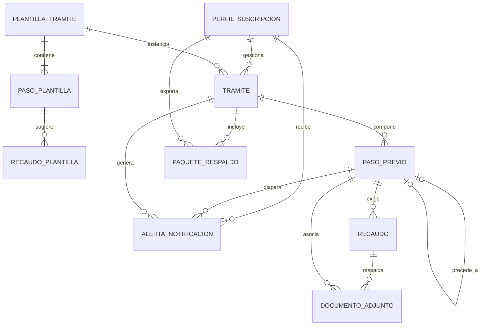

# Modelo Lógico de Datos — Gestor de Trámites y Vencimientos Burocráticos/Legales con Dependencias

**Fecha:** 20 de noviembre de 2026  
**Título:** Modelo Lógico de Datos (MVP) — Gestor de Trámites y Vencimientos Burocráticos/Legales con Dependencias

---

## Diagrama Entidad-Relación (Estilo Patas de Gallina)

# Diccionario del Modelo Lógico de Datos

## Entidades

### `ALERTA_NOTIFICACION`

- **Resumen:** Entidad persistente (con ciclo de vida operativo vinculado a la programación y entrega de avisos) que representa cada alerta programada o emitida hacia el servicio nativo del dispositivo para apertura de ventana de acción o riesgo de vencimiento.
- **Atributos:**
  - `id_alerta`: Identificador único
  - `id_tramite`: Referencia al trámite asociado
  - `id_paso_previo`: Referencia opcional al paso previo asociado
  - `id_perfil`: Referencia al perfil de usuario destinatario
  - `tipo_alerta`: Tipo de aviso de ventana o proximidad/riesgo
  - `fecha_programada`: Fecha y hora calculada de disparo
  - `estado_alerta`: Estado actual de programación, entrega o descarte
  - `persistente_tras_reinicio`: Indicador de persistencia ante reinicio del dispositivo
  - `fecha_emision`: Fecha y hora efectiva de entrega, si aplica
- **Valores/Rangos Aceptados:**
  - `tipo_alerta`: `'APERTURA_VENTANA'`, `'RIESGO_VENCIMIENTO'`
  - `estado_alerta`: `'PROGRAMADA'`, `'EMITIDA'`, `'SILENCIADA_LATENTE'`, `'CANCELADA'`
  - `persistente_tras_reinicio`: `'VERDADERO'`, `'FALSO'`
- **Relaciones:**
  - Un `TRAMITE` puede generar muchas `ALERTA_NOTIFICACION`.
  - Un `PASO_PREVIO` puede disparar muchas `ALERTA_NOTIFICACION`.
  - Un `PERFIL_SUSCRIPCION` puede recibir muchas `ALERTA_NOTIFICACION`.

---

### `DOCUMENTO_ADJUNTO`

- **Resumen:** Entidad persistente que almacena los metadatos y la referencia al archivo cifrado en almacenamiento local (imágenes/fotografías o PDFs) asociado a un recaudo o paso previo para consulta rápida y disponibilidad offline.
- **Atributos:**
  - `id_documento`: Identificador único
  - `id_recaudo`: Referencia opcional al recaudo respaldado
  - `id_paso_previo`: Referencia opcional al paso previo asociado
  - `nombre_archivo`: Nombre descriptivo o de archivo estándar
  - `formato_archivo`: Tipo/formato documental admitido
  - `tamano_bytes`: Tamaño del archivo en bytes
  - `ruta_almacenamiento_cifrado`: Ruta o identificador local del objeto cifrado en reposo
  - `estado_cifrado`: Estado de cifrado en reposo
  - `disponible_offline`: Disponibilidad sin conexión a internet
  - `fecha_carga`: Fecha y hora de incorporación
- **Valores/Rangos Aceptados:**
  - `nombre_archivo`: 1 a 255 caracteres
  - `formato_archivo`: `'PDF'`, `'JPG'`, `'JPEG'`, `'PNG'`, `'WEBP'`
  - `tamano_bytes`: mayor que 0 bytes
  - `estado_cifrado`: `'CIFRADO_EN_REPOSO'`
  - `disponible_offline`: `'SI'`, `'NO'`
- **Relaciones:**
  - Un `RECAUDO` puede ser respaldado por muchos `DOCUMENTO_ADJUNTO`.
  - Un `PASO_PREVIO` puede tener asociados muchos `DOCUMENTO_ADJUNTO`.

---

### `PAQUETE_RESPALDO`

- **Resumen:** Entidad transitoria (generada bajo demanda durante la operación de exportación de respaldo y entregada como archivo portable) que agrupa los datos estructurados y documentos adjuntos exportados por un usuario con plan Personal Pro.
- **Atributos:**
  - `id_respaldo`: Identificador único de la exportación
  - `id_perfil`: Referencia al perfil que solicita la exportación
  - `id_tramite`: Referencia opcional si se exporta un trámite específico; nulo si es respaldo general
  - `alcance_exportacion`: Alcance del respaldo solicitado
  - `formato_paquete`: Formato estándar portable de salida
  - `estado_generacion`: Estado transitorio de preparación o entrega del paquete
  - `fecha_solicitud`: Fecha y hora en que se solicitó la exportación
- **Valores/Rangos Aceptados:**
  - `alcance_exportacion`: `'TRAMITE_UNICO'`, `'TODOS_LOS_TRAMITES'`
  - `formato_paquete`: `'ZIP_ESTANDAR'`, `'JSON_ESTANDAR'`
  - `estado_generacion`: `'EN_PROCESO'`, `'LISTO_PARA_ENTREGA'`, `'ENTREGADO'`, `'ERROR'`
- **Relaciones:**
  - Un `PERFIL_SUSCRIPCION` puede exportar muchos `PAQUETE_RESPALDO`.
  - Un `TRAMITE` puede estar incluido en muchos `PAQUETE_RESPALDO`.

---

### `PASO_PLANTILLA`

- **Resumen:** Entidad persistente de catálogo que define un paso previo o prerequisito sugerido dentro de una plantilla base de trámite, incluyendo su orden secuencial y tiempo de anticipación.
- **Atributos:**
  - `id_paso_plantilla`: Identificador único
  - `id_plantilla`: Referencia a la plantilla base a la que pertenece
  - `nombre_paso`: Nombre del prerequisito sugerido
  - `orden_secuencia`: Posición ordinal de dependencia secuencial
  - `valor_anticipacion`: Cantidad numérica de tiempo de anticipación o duración
  - `unidad_anticipacion`: Unidad temporal de la anticipación
- **Valores/Rangos Aceptados:**
  - `nombre_paso`: 1 a 150 caracteres
  - `orden_secuencia`: entero mayor o igual a 1
  - `valor_anticipacion`: entero mayor o igual a 1
  - `unidad_anticipacion`: `'DIAS'`, `'SEMANAS'`, `'MESES'`
- **Relaciones:**
  - Una `PLANTILLA_TRAMITE` contiene uno o muchos `PASO_PLANTILLA`.
  - Un `PASO_PLANTILLA` sugiere uno o muchos `RECAUDO_PLANTILLA`.

---

### `PASO_PREVIO`

- **Resumen:** Entidad persistente que representa cada prerequisito o etapa intermedia dentro de un trámite concreto, con su orden secuencial, anticipación configurada y fechas calculadas mediante cuenta regresiva inversa.
- **Atributos:**
  - `id_paso_previo`: Identificador único
  - `id_tramite`: Referencia al trámite al que pertenece
  - `id_paso_siguiente`: Referencia opcional al siguiente paso en la cadena de dependencia secuencial
  - `nombre_paso`: Denominación del paso previo
  - `orden_secuencia`: Orden de dependencia secuencial dentro del trámite
  - `valor_anticipacion`: Tiempo estimado de anticipación o duración del paso
  - `unidad_anticipacion`: Unidad de tiempo de la anticipación
  - `fecha_inicio_calculada`: Fecha calculada de apertura de ventana / inicio del paso
  - `fecha_vencimiento_calculada`: Fecha calculada límite interna del paso previo
  - `estado_paso`: Estado operativo del paso
  - `es_paso_critico`: Indicador de si corresponde al próximo paso crítico a ejecutar
- **Valores/Rangos Aceptados:**
  - `nombre_paso`: 1 a 150 caracteres
  - `orden_secuencia`: entero mayor o igual a 1
  - `valor_anticipacion`: entero mayor o igual a 1
  - `unidad_anticipacion`: `'DIAS'`, `'SEMANAS'`, `'MESES'`
  - `estado_paso`: `'PENDIENTE'`, `'LISTO_COMPLETADO'`
  - `es_paso_critico`: `'SI'`, `'NO'`
- **Relaciones:**
  - Un `TRAMITE` compone cero o muchos `PASO_PREVIO`.
  - Un `PASO_PREVIO` puede preceder a cero o un `PASO_PREVIO` siguiente (y ser precedido por cero o un `PASO_PREVIO` anterior dentro de la cadena).
  - Un `PASO_PREVIO` exige cero o muchos `RECAUDO`.
  - Un `PASO_PREVIO` puede tener asociados cero o muchos `DOCUMENTO_ADJUNTO`.
  - Un `PASO_PREVIO` puede disparar cero o muchas `ALERTA_NOTIFICACION`.

---

### `PERFIL_SUSCRIPCION`

- **Resumen:** Entidad persistente que representa el estado comercial y de licenciamiento del usuario en el dispositivo (Freemium o Personal Pro), regulando los límites operativos y la restauración de compras.
- **Atributos:**
  - `id_perfil`: Identificador único del perfil
  - `plan_activo`: Nivel comercial vigente del usuario
  - `modalidad_pago`: Tipo de adquisición comercial cuando aplica
  - `estado_licencia`: Estado de vigencia o validación de la licencia
  - `limite_tramites_activos`: Máximo de trámites activos simultáneos permitidos
  - `limite_archivos_adjuntos`: Máximo de archivos adjuntos totales permitidos
  - `limite_plantillas_base`: Cantidad de plantillas base habilitadas en el catálogo
  - `permite_exportacion_respaldo`: Habilitación para exportar respaldos
  - `fecha_ultima_validacion`: Fecha y hora de validación o restauración con la pasarela nativa
- **Valores/Rangos Aceptados:**
  - `plan_activo`: `'FREEMIUM'`, `'PERSONAL_PRO'`
  - `modalidad_pago`: `'NINGUNA'`, `'LIFETIME'`, `'SUSCRIPCION_ANUAL'`
  - `estado_licencia`: `'ACTIVA'`, `'RESTAURADA'`, `'INACTIVA'`
  - `limite_tramites_activos`: 3 para `'FREEMIUM'`; ilimitado (sin restricción) para `'PERSONAL_PRO'`
  - `limite_archivos_adjuntos`: 5 para `'FREEMIUM'`; ilimitado (sin restricción) para `'PERSONAL_PRO'`
  - `limite_plantillas_base`: 2 para `'FREEMIUM'`; todas disponibles para `'PERSONAL_PRO'`
  - `permite_exportacion_respaldo`: `'NO'` para `'FREEMIUM'`; `'SI'` para `'PERSONAL_PRO'`
- **Relaciones:**
  - Un `PERFIL_SUSCRIPCION` gestiona cero o muchos `TRAMITE`.
  - Un `PERFIL_SUSCRIPCION` recibe cero o muchas `ALERTA_NOTIFICACION`.
  - Un `PERFIL_SUSCRIPCION` puede exportar cero o muchos `PAQUETE_RESPALDO`.

---

### `PLANTILLA_TRAMITE`

- **Resumen:** Entidad persistente de catálogo que almacena estructuras base preconfiguradas de trámites comunes (como pasaporte, licencia o seguro) para clonar y ajustar rápidamente.
- **Atributos:**
  - `id_plantilla`: Identificador único
  - `nombre_plantilla`: Nombre de la plantilla base
  - `categoria`: Categoría del trámite sugerido
  - `descripcion`: Descripción breve de la plantilla
  - `acceso_nivel`: Disponibilidad comercial de la plantilla en el catálogo
- **Valores/Rangos Aceptados:**
  - `nombre_plantilla`: 1 a 120 caracteres
  - `categoria`: `'PASAPORTE'`, `'LICENCIA'`, `'SEGURO'`, `'LEGAL'`, `'BUROCRATICO'`, `'OTRO'`
  - `descripcion`: 0 a 500 caracteres
  - `acceso_nivel`: `'GRATUITA_INICIAL'`, `'PERSONAL_PRO'`
- **Relaciones:**
  - Una `PLANTILLA_TRAMITE` contiene uno o muchos `PASO_PLANTILLA`.
  - Una `PLANTILLA_TRAMITE` puede ser instanciada en cero o muchos `TRAMITE`.

---

### `RECAUDO`

- **Resumen:** Entidad persistente que representa cada requisito o recaudo documental exigido dentro de un paso previo, controlando su estado de preparación para el trámite y la vista de taquilla.
- **Atributos:**
  - `id_recaudo`: Identificador único
  - `id_paso_previo`: Referencia al paso previo al que pertenece
  - `nombre_recaudo`: Nombre o descripción del requisito documental
  - `estado_recaudo`: Estado de preparación del recaudo
  - `notas_recaudo`: Anotaciones complementarias sobre el recaudo
- **Valores/Rangos Aceptados:**
  - `nombre_recaudo`: 1 a 180 caracteres
  - `estado_recaudo`: `'PENDIENTE'`, `'LISTO'`
  - `notas_recaudo`: 0 a 500 caracteres
- **Relaciones:**
  - Un `PASO_PREVIO` exige cero o muchos `RECAUDO`.
  - Un `RECAUDO` puede ser respaldado por cero o muchos `DOCUMENTO_ADJUNTO`.

---

### `RECAUDO_PLANTILLA`

- **Resumen:** Entidad persistente de catálogo que define un recaudo o requisito documental sugerido dentro de un paso de una plantilla base.
- **Atributos:**
  - `id_recaudo_plantilla`: Identificador único
  - `id_paso_plantilla`: Referencia al paso de plantilla al que pertenece
  - `nombre_recaudo`: Nombre del recaudo sugerido
  - `notas_sugeridas`: Indicaciones sugeridas para el recaudo
- **Valores/Rangos Aceptados:**
  - `nombre_recaudo`: 1 a 180 caracteres
  - `notas_sugeridas`: 0 a 500 caracteres
- **Relaciones:**
  - Un `PASO_PLANTILLA` sugiere cero o muchos `RECAUDO_PLANTILLA`.

---

### `TRAMITE`

- **Resumen:** Entidad persistente central que representa un trámite o vencimiento burocrático/legal gestionado por el usuario, anclado a una fecha límite final y evaluado según su ventana de acción y progreso.
- **Atributos:**
  - `id_tramite`: Identificador único
  - `id_perfil`: Referencia al perfil de usuario propietario
  - `id_plantilla_origen`: Referencia opcional a la plantilla base desde la cual fue clonado
  - `titulo`: Título del trámite
  - `categoria`: Categoría del trámite
  - `fecha_limite_final`: Fecha objetivo de vencimiento o presentación máxima
  - `notas_generales`: Notas generales asociadas al trámite
  - `estado_operativo`: Estado del trámite respecto a la fecha actual y dependencias
  - `porcentaje_avance`: Porcentaje de avance calculado según recaudos/pasos completados
  - `activo_en_limite`: Indicador de si el trámite computa como activo para límites del plan
  - `fecha_creacion`: Fecha y hora de creación del trámite
- **Valores/Rangos Aceptados:**
  - `titulo`: 1 a 150 caracteres
  - `categoria`: `'PASAPORTE'`, `'LICENCIA'`, `'SEGURO'`, `'LEGAL'`, `'BUROCRATICO'`, `'OTRO'`
  - `notas_generales`: 0 a 2000 caracteres
  - `estado_operativo`: `'EN_ESPERA_LATENTE'`, `'EN_VENTANA_DE_ACCION'`, `'EN_RIESGO'`, `'COMPLETADO'`
  - `porcentaje_avance`: 0 a 100 (porcentaje numérico)
  - `activo_en_limite`: `'SI'`, `'NO'`
- **Relaciones:**
  - Un `PERFIL_SUSCRIPCION` gestiona cero o muchos `TRAMITE`.
  - Una `PLANTILLA_TRAMITE` puede originar cero o muchos `TRAMITE`.
  - Un `TRAMITE` compone cero o muchos `PASO_PREVIO`.
  - Un `TRAMITE` genera cero o muchas `ALERTA_NOTIFICACION`.
  - Un `TRAMITE` puede incluirse en cero o muchos `PAQUETE_RESPALDO`.

---

## Valores Aceptados

### Acceso de Plantilla (`acceso_nivel`)
- `'GRATUITA_INICIAL'`
- `'PERSONAL_PRO'`

### Alcance de Exportación (`alcance_exportacion`)
- `'TRAMITE_UNICO'`
- `'TODOS_LOS_TRAMITES'`

### Categoría de Trámite (`categoria`)
- `'PASAPORTE'`
- `'LICENCIA'`
- `'SEGURO'`
- `'LEGAL'`
- `'BUROCRATICO'`
- `'OTRO'`

### Estado de Alerta (`estado_alerta`)
- `'PROGRAMADA'`
- `'EMITIDA'`
- `'SILENCIADA_LATENTE'`
- `'CANCELADA'`

### Estado de Cifrado (`estado_cifrado`)
- `'CIFRADO_EN_REPOSO'`

### Estado de Generación de Respaldo (`estado_generacion`)
- `'EN_PROCESO'`
- `'LISTO_PARA_ENTREGA'`
- `'ENTREGADO'`
- `'ERROR'`

### Estado de Licencia (`estado_licencia`)
- `'ACTIVA'`
- `'RESTAURADA'`
- `'INACTIVA'`

### Estado Operativo de Trámite (`estado_operativo`)
- `'EN_ESPERA_LATENTE'`
- `'EN_VENTANA_DE_ACCION'`
- `'EN_RIESGO'`
- `'COMPLETADO'`

### Estado de Paso Previo (`estado_paso`)
- `'PENDIENTE'`
- `'LISTO_COMPLETADO'`

### Estado de Recaudo (`estado_recaudo`)
- `'PENDIENTE'`
- `'LISTO'`

### Formato de Archivo Adjunto (`formato_archivo`)
- `'PDF'`
- `'JPG'`
- `'JPEG'`
- `'PNG'`
- `'WEBP'`

### Formato de Paquete de Respaldo (`formato_paquete`)
- `'ZIP_ESTANDAR'`
- `'JSON_ESTANDAR'`

### Indicadores Booleanos / Binarios (`persistente_tras_reinicio`, `disponible_offline`, `es_paso_critico`, `permite_exportacion_respaldo`, `activo_en_limite`)
- `'VERDADERO'`, `'FALSO'`
- `'SI'`, `'NO'`

### Modalidad de Pago (`modalidad_pago`)
- `'NINGUNA'`
- `'LIFETIME'`
- `'SUSCRIPCION_ANUAL'`

### Plan Activo (`plan_activo`)
- `'FREEMIUM'`
- `'PERSONAL_PRO'`

### Tipo de Alerta (`tipo_alerta`)
- `'APERTURA_VENTANA'`
- `'RIESGO_VENCIMIENTO'`

### Unidad de Anticipación (`unidad_anticipacion`)
- `'DIAS'`
- `'SEMANAS'`
- `'MESES'`